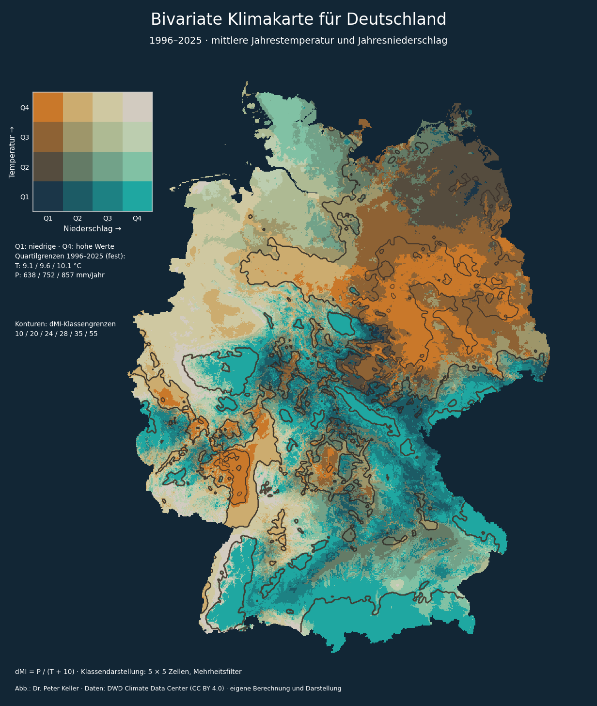
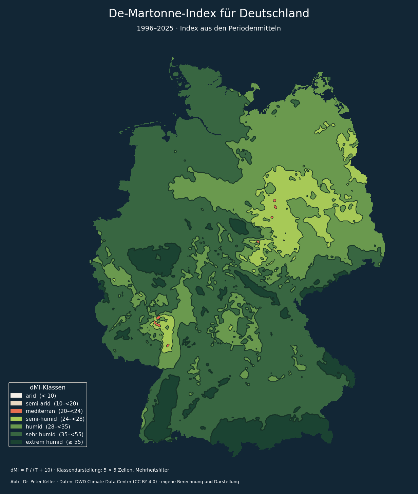

# Drought – Klimakarten für Deutschland

Wie spielen Temperatur und Niederschlag zusammen – und wie verändert sich dieses Bild über die Jahre? Dieses Projekt stellt beide Größen in einer bivariaten Karte gegenüber und ergänzt sie um die Klassengrenzen des De-Martonne-Ariditätsindex. Die Grundlage bilden jährliche DWD-Raster von 1996 bis 2025.



Die Farben zeigen die Kombination aus Temperatur und Niederschlag. Ocker steht für vergleichsweise warm und niederschlagsarm, Türkis für kühl und niederschlagsreich. Die Konturen legen die geglätteten De-Martonne-Klassen darüber. So bleiben die beiden Eingangsgrößen sichtbar, während sich ihre Zusammenfassung im Index gleichzeitig vergleichen lässt.

## Karten und Zeitreihe

- Bivariate Temperatur-Niederschlags-Karte, mit und ohne Konturen.
- De-Martonne-Karte mit festen Klassengrenzen.
- Gleitende Fünfjahresfenster von 1996–2000 bis 2021–2025 und eine GIF-Animation.



Die bivariate Ansicht ohne Konturen liegt [hier](figures/bivariate_1996_2025.png). Dunkler Hintergrund, Farbpaletten und Kartenidee stammen aus den ursprünglichen Analysen von Dr. Peter Keller.


Die Animation zeigt 26 überlappende Zeitfenster; benachbarte Bilder teilen sich jeweils vier Jahre. Die Klassen bleiben unverändert. Die zugehörigen Parameter und Eingabeprüfsummen stehen in [rolling_run.json](figures/rolling_run.json).

## Ausführen

Python 3.10 oder neuer. Im Projektverzeichnis:

```powershell
python -m venv .venv
.venv\Scripts\python -m pip install .
.venv\Scripts\python -m drought download --start 1996 --end 2025
.venv\Scripts\python -m drought render --start 1996 --end 2025
```

Unter Linux/macOS lautet der Python-Pfad `.venv/bin/python`. Der Download legt die Raster in `data/` ab. Die Ergebnisse werden in `outputs/` gespeichert. Beide Ordner bleiben außerhalb der Versionsverwaltung. Eine zusätzliche Deutschland-Geometrie wird nicht benötigt.

Gleitende Fünfjahresfenster und Animation:

```powershell
.venv\Scripts\python -m drought render --start 1996 --end 2025 --window 5 --gif
```

Eine einzelne Konturkarte als PDF:

```powershell
.venv\Scripts\python -m drought render --start 2021 --end 2025 --kind contours --format pdf --output-dir outputs/pdf
```

`--data-dir` und `--output-dir` wählen Ein- und Ausgabeordner. `--format` unterstützt PNG, PDF und SVG; `--dpi` steuert die Auflösung. Das feste Seitenformat hält die Animation ruhig. `--frame-ms` setzt die Anzeigedauer je GIF-Bild. PDF und SVG enthalten die Rasterkarte als eingebettetes Bild.

Die Eingabeordner heißen `Precipitation` und `Temperature`. Neben den offiziellen Download-Dateinamen werden die ursprünglichen Namen `RSMS_17_<Jahr>_01.asc` und `TAMM_17_<Jahr>_01.asc` unterstützt. Vorhandene Download-Dateien werden geprüft und nicht erneut heruntergeladen.

Weitere Optionen zeigt `python -m drought render --help`.

Wer interaktiv arbeiten möchte, kann mit `python -m pip install ".[notebook]"` Jupyter ergänzen und [Analyse.ipynb](Analyse.ipynb) öffnen. Das Notebook führt durch Periodenmittel und die drei Kartenansichten; seine Ausgaben werden neu berechnet.

## Berechnung und Interpretation

Der Index wird **aus den Periodenmitteln** berechnet:

```text
dMI = mittlerer Jahresniederschlag in mm / (mittlere Jahrestemperatur in °C + 10)
```

Das ist nicht das arithmetische Mittel der jährlich berechneten Indizes. Kleine Werte stehen für ein arideres Verhältnis von Niederschlag zu Temperatur. Das Verfahren beschreibt klimatische Trockenheit; aus diesen Jahres- und Mehrjahresmitteln lässt sich keine Aussage über einzelne Dürreereignisse, Bodenfeuchte oder saisonalen Wasserstress ableiten. Zur Formel siehe beispielsweise [die Anwendung in Annals of Botany](https://academic.oup.com/aob/article/131/6/941/7095679).

**Klassen:** Die im ursprünglichen Projekt gewählte Einteilung bleibt erhalten. Sie ist eine projektspezifische Darstellung, keine DWD-Klassifikation. Insbesondere ist „mediterran“ hier ein Klassenname und keine Zuordnung zu einer umfassenden Klimazone.

| dMI | Bezeichnung im Projekt |
|---|---|
| < 10 | arid |
| 10 bis < 20 | semi-arid |
| 20 bis < 24 | mediterran |
| 24 bis < 28 | semi-humid |
| 28 bis < 35 | humid |
| 35 bis < 55 | sehr humid |
| ≥ 55 | extrem humid |

**Quartile:** Standardmäßig werden die Grenzen aus den räumlichen Periodenmitteln des gesamten gewählten Zeitraums bestimmt und für alle Zeitfenster beibehalten (`--quartiles reference`). Damit bleiben Farben innerhalb eines Laufs vergleichbar. Getrennte Aufrufe mit unterschiedlichen Gesamtzeiträumen haben unterschiedliche Referenzen. Mit `--quartiles window` entstehen – wie im ursprünglichen Notebook – je Fenster neue Quartile; die Farben zeigen dann relative räumliche Positionen, keine festen Temperatur- oder Niederschlagsbereiche. Gleiche Messwerte bleiben in derselben Klasse, auch wenn dadurch die Klassen ungleich groß oder leer werden.

**Glättung:** Ein 5 × 5-Zellen-Mehrheitsfilter beruhigt ausschließlich die gezeichneten dMI-Klassen. Index und bivariate Eingangswerte bleiben unverändert. Die Konturen sind Grenzen dieser geglätteten Klassen, keine exakten Isolinien des kontinuierlichen Index. Bei gleicher Häufigkeit gewinnt die niedrigere Klasse. `--smoothing median` wählt einen Medianfilter, `--smoothing none` schaltet die Glättung ab; `--smooth-size` verändert die ungerade Fenstergröße. NoData-Flächen werden weder aufgefüllt noch als niedrige Klasse mitgezählt.

**Datenprüfung:** Raster müssen in Form und Lage übereinstimmen. Jede verwendete Zelle braucht für beide Variablen alle Jahre des betrachteten Zeitfensters. Fehlende Werte werden vor der Umrechnung der Temperatur von Zehntelgrad in °C maskiert. Negative Niederschläge und ein Nenner ≤ 0 werden ausgeschlossen. Das dokumentierte Koordinatensystem ist EPSG:31467; bei ASCII-Rastern ohne CRS-Eintrag wird es vorausgesetzt. Unterschiede im gültigen räumlichen Bereich zwischen Zeitfenstern können bestehen.

`run.json` speichert Parameter, Quartilgrenzen, gültige Zellzahlen und SHA-256-Prüfsummen der Eingabedateien ohne lokale absolute Pfade. Der Download erzeugt zusätzlich ein Quellenmanifest. DWD-Daten können nachträglich revidiert werden; Prüfsummen helfen, den verwendeten Stand zu unterscheiden.

## Daten und Quellen

- DWD Climate Data Center (CDC): [Annual sum of monthly precipitation grids over Germany, v1.0](https://opendata.dwd.de/climate_environment/CDC/grids_germany/annual/precipitation/DESCRIPTION_gridsgermany_annual_precipitation_en.pdf), jährlicher Niederschlag in mm.
- DWD Climate Data Center (CDC): [Annual grids of monthly averaged daily air temperature (2m) over Germany, v1.0](https://opendata.dwd.de/climate_environment/CDC/grids_germany/annual/air_temperature_mean/DESCRIPTION_gridsgermany_annual_air_temperature_mean_en.pdf), Jahrestemperatur in Zehntelgrad °C.

Die Raster haben eine Zellgröße von 1 km. Sie beruhen auf interpolierten Stationsdaten; räumliche Auflösung ist nicht mit lokaler Messgenauigkeit gleichzusetzen. Änderungen im Stationsnetz und die Interpolation begrenzen die Interpretation.

Die DWD-Daten stehen gemäß den [CDC-Nutzungsbedingungen](https://opendata.dwd.de/climate_environment/CDC/Terms_of_use.pdf) unter [CC BY 4.0](https://creativecommons.org/licenses/by/4.0/). Die Karten sind eigene Bearbeitungen: zeitliche Mittelung, Indexberechnung, Klassifikation und kartografische Darstellung. Sie sind keine amtlichen DWD-Karten.

## Projektstruktur und Tests

`drought/` enthält Datenzugriff, Berechnung, Darstellung und CLI. `tests/` prüft Formel, Klassengrenzen, fehlende Werte, Rasterausrichtung, Glättung und Quartile mit kleinen synthetischen Beispielen. `figures/` enthält die ausgewählten README-Abbildungen und ihre Berechnungsparameter.

```powershell
python -m unittest discover -s tests -v
```

Die Analyse benötigt keinen gespeicherten Notebook-Kernelzustand. Daten, temporäre Exporte und lokale Konfigurationen gehören nicht zum Repository.

## Lizenz

Quellcode: [MIT](LICENSE), © 2026 Peter Keller. Die beigefügten Karten stehen unter CC BY 4.0; Namensnennung: Dr. Peter Keller, Daten: DWD Climate Data Center. Für die zugrunde liegenden DWD-Daten gelten deren oben verlinkte Bedingungen.
